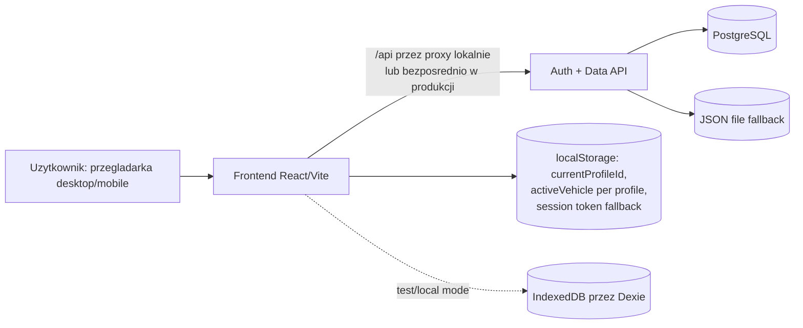

# ARCHITECTURE

## 1. Cel dokumentu

Ten dokument opisuje aktualna architekture techniczna aplikacji AUTOlog (Carlog/Fura), jej tryb runtime, przeplywy danych, warstwy odpowiedzialnosci oraz decyzje projektowe.

Dokument odzwierciedla aktualny stan kodu: frontend dziala w modelu backend-first (remote runtime), a backend odpowiada za auth, autoryzacje i trwale dane domenowe.

## 2. Kontekst produktu i zakres systemu

AUTOlog to webowa aplikacja mobile-first do prowadzenia historii serwisowej pojazdow:

- rejestracja i logowanie profilu
- zarzadzanie pojazdami przypisanymi do profilu
- zarzadzanie wpisami serwisowymi (historia + plan)
- zmiana hasla z aktywnej sesji
- izolacja danych per profil

## 3. Stack technologiczny

### 3.1 Frontend

- React 19
- TypeScript (strict)
- Vite 8
- Tailwind CSS v4
- Radix UI + komponenty wspoldzielone (styl shadcn-like)
- React Hook Form + Zod
- Lucide React

### 3.2 Backend

- Node.js (HTTP server oparty o node:http)
- modulowa logika auth i danych
- pg dla PostgreSQL

### 3.3 Data i storage

- PostgreSQL jako docelowe storage runtime
- fallback file storage (server/data/auth-db.json) dla prostego lokalnego uruchomienia
- Dexie/IndexedDB utrzymane jako lokalny adapter i zaplecze testowe/legacy

### 3.4 Testy i jakosc

- Vitest (unit/integration frontend + backend)
- React Testing Library
- Playwright (E2E)
- Oxlint
- TypeScript build/typecheck

### 3.5 Deploy

- Render: osobny serwis API (fura-api) i osobny static frontend (fura-web)
- zarzadzana baza PostgreSQL (fura-db)

## 4. Architektura wysokiego poziomu

## 5. Tryby runtime i polityka wyboru adapterow

### 5.1 Domyslny runtime

W aktualnej konfiguracji aplikacja uruchamia sie jako remote poza testami:

- authMode = remote gdy import.meta.env.MODE !== test
- authMode = local tylko dla testow (MODE=test)

Implikacje:

- frontend traktuje backend jako source of truth dla auth i danych domenowych,
- repozytoria frontendowe kieruja CRUD do endpointow /api/*,
- lokalny adapter Dexie pozostaje kompatybilnoscia i wsparciem testowym.

### 5.2 Lokalny stan sesji po stronie frontendu

Frontend utrzymuje lekki stan klienta:

- currentProfileId w localStorage
- aktywny pojazd per profil (activeVehicle:<profileId>) w localStorage
- fallback bearer token sesji w localStorage (dla scenariuszy, gdzie cookie miedzy originami jest niewystarczajace)

## 6. Frontend: warstwy i odpowiedzialnosci

### 6.1 Kompozycja aplikacji

- src/main.tsx: bootstrap React
- src/App.tsx: alias eksportujacy glowna aplikacje
- src/app/App.tsx: glowne orkiestrator UI, stany, efekty i przeplyw uzytkownika

src/app/App.tsx odpowiada m.in. za:

- bootstrap sesji (authService.getCurrentProfileId())
- przelaczenie miedzy ekranem auth i ekranem glownym
- ladowanie profilu, pojazdow i wpisow serwisowych
- zapis i odczyt aktywnego pojazdu
- obsluge bledow runtime i fallback UX

### 6.2 Moduly feature

- src/features/auth: logowanie/rejestracja/zmiana hasla i kontrakt auth
- src/features/profile: menu profilu i ustawienia
- src/features/vehicles: formularze i karuzela pojazdow
- src/features/service-events: lista, detal i formularz wpisow serwisowych

### 6.3 Shared layer

- src/shared/components: wspoldzielone komponenty UI
- src/shared/lib: narzedzia (HTTP client, token sesji, formatowanie, utilsy)
- src/shared/types/domain.ts: kontrakty typow domenowych
- src/shared/config/app-config.ts: centralna konfiguracja runtime

### 6.4 Data access w frontendzie

Repozytoria (src/data/repositories/*) sa jedynym punktem dostepu do danych dla UI.

Model wzorcowy:

1. Feature/UI wywoluje metode repozytorium.
2. Repozytorium wybiera transport zaleznie od trybu (remote vs local).
3. W trybie remote wykonywane jest zadanie HTTP do API.
4. W trybie local operacja idzie do Dexie.

Korzyści:

- brak bezposredniego dostepu komponentow do transportu i storage,
- prostsza podmiana adapterow,
- spojnosc walidacji i transformacji payloadow.

## 7. Backend: warstwy i odpowiedzialnosci

### 7.1 Modul auth server

server/auth-server.mjs realizuje:

- routing HTTP
- CORS
- sesje i cookies
- mapowanie bledow
- endpointy auth
- endpointy danych (profiles, vehicles, service-events)

### 7.2 Modul logiki auth

auth-core.mjs zawiera czysta logike domenowa auth:

- normalizacja username
- walidacja hasel
- rejestracja/logowanie
- reset i zmiana hasla
- hashowanie hasel (crypto.scryptSync) + timingSafeEqual

### 7.3 Modul storage

storage.mjs realizuje:

- autodetekcje trybu storage (postgres lub file fallback)
- inicjalizacje i migracje schematu PostgreSQL
- migracje danych legacy z JSON app_state do tabel znormalizowanych
- retry z backoffem i jitterem dla bledow transient DB
- mapowanie bledow technicznych na bezpieczne komunikaty runtime

## 8. Kontrakty domenowe

Glowne encje (src/shared/types/domain.ts):

- UserProfile
- Vehicle
- ServiceEvent
- AuthCredentialRecord (warstwa auth)

Kluczowe zasady modelu:

- rekordy domenowe sa scope'owane po profileId,
- wpis serwisowy jest powiazany z vehicleId i profileId,
- waluta wpisow serwisowych jest utrzymywana jako PLN,
- daty i znaczniki czasu sa zapisywane jako ISO string.

## 9. Autentykacja, autoryzacja i sesje

### 9.1 Mechanizm sesji

- serwer tworzy sessionId (UUID) i utrzymuje mapowanie sessionId -> profileId in-memory,
- cookie sesyjne: HttpOnly, SameSite, opcjonalnie Secure,
- wsparcie fallback Authorization: Bearer <sessionId>.

### 9.2 Zasady dostepu

- brak aktywnej sesji => 401 dla zasobow chronionych,
- operacje profilu wymagaja zgodnosci sessionProfileId z target profileId,
- zasoby pojazdow i wpisow sa filtrowane po aktywnym profileId sesji,
- logout uniewaznia wszystkie aktywne sesje danego profilu.

### 9.3 Operacje auth

- POST /api/auth/register
- POST /api/auth/login
- GET /api/auth/session
- POST /api/auth/logout
- POST /api/auth/change-password
- POST /api/auth/reset-password (wymaga aktywnej sesji i zgodnosci profilu)

## 10. API danych

### 10.1 Profile

- GET /api/profiles: zwraca tylko profil biezacej sesji (nie liste wszystkich profili)
- PUT /api/profiles/:id: aktualizacja displayName wylacznie dla profilu biezacej sesji

### 10.2 Vehicles

- GET /api/vehicles
- POST /api/vehicles
- PUT /api/vehicles/:id
- DELETE /api/vehicles/:id

### 10.3 Service events

- GET /api/service-events?vehicleId=...
- GET /api/service-events/:id
- POST /api/service-events
- PUT /api/service-events/:id
- DELETE /api/service-events/:id

Serwer wykonuje walidacje i normalizacje payloadow (np. pola tekstowe, liczby, location, status).

## 11. Przeplywy end-to-end

### 11.1 Boot aplikacji

1. Frontend uruchamia App.
2. authService.getCurrentProfileId() pyta backend o sesje (/api/auth/session).
3. Gdy sesja istnieje, ladowane sa profil, pojazdy i wpisy.
4. Gdy sesji brak, prezentowany jest ekran auth.

### 11.2 Logowanie

1. Uzytkownik wysyla login/haslo.
2. Backend weryfikuje credentials.
3. Backend zwraca profil i identyfikator sesji, ustawia cookie.
4. Frontend zapisuje lekki stan sesji i przechodzi do workspace profilu.

### 11.3 CRUD pojazdu/wpisu

1. Formularz feature buduje dane wejsciowe.
2. Repozytorium mapuje dane do payloadu API.
3. API waliduje i zapisuje rekordy scope'owane profilem sesji.
4. Frontend odswieza liste i aktualizuje aktywny kontekst UI.

## 12. Konfiguracja i srodowisko

### 12.1 Frontend ENV

- VITE_API_BASE_URL (domyslnie /api)
- VITE_API_PROXY_TARGET (lokalny target proxy Vite)
- VITE_GOOGLE_MAPS_API_KEY (opcjonalna integracja map)

### 12.2 Backend ENV

- AUTH_API_PORT, PORT, AUTH_API_HOST
- AUTH_API_ALLOWED_ORIGINS
- AUTH_COOKIE_SAME_SITE, AUTH_COOKIE_SECURE
- AUTH_STORAGE
- AUTH_DATABASE_URL / DATABASE_URL / INTERNAL_DATABASE_URL
- parametry retry/pool DB (AUTH_DATABASE_*)

## 13. Niezawodnosc i obsluga bledow

- backend rozroznia bledy walidacyjne od systemowych,
- bledy storage mapowane sa do kontrolowanych odpowiedzi (StorageError),
- problemy transient PostgreSQL sa retry'owane z backoffem,
- frontend pokazuje user-safe komunikaty przy braku polaczenia z API,
- endpoint zdrowia: GET /api/health.

## 14. Bezpieczenstwo

Aktualnie zaimplementowane:

- hashowanie hasel po stronie backendu (scrypt + losowa sol),
- porownania hashy odporne na timing attack (timingSafeEqual),
- sesja cookie HttpOnly + polityki CORS,
- kontrola dostepu rekordow po aktywnym profilu sesji.

Ograniczenia aktualnej implementacji:

- sesje sa utrzymywane in-memory (restart procesu uniewaznia sesje),
- fallback bearer token moze byc przechowywany po stronie klienta,
- brak dedykowanego zewnetrznego provider'a IAM.

## 15. Testowalnosc i strategia QA

Warstwy testow:

- backend unit (auth-core)
- backend API integration
- frontend integration (Vitest + RTL)
- regression suites
- E2E (Playwright, w tym mobile flow)

Bramka developerska:

- npm run verify = lint + typecheck + test + build
- npm run verify:full = verify + e2e

## 16. Architektura deploy i operacyjna

Render (render.yaml) definiuje:

- fura-api (Node web service)
- fura-web (static site)
- fura-db (PostgreSQL)

Model operacyjny:

- frontend i API sa rozdzielone jako osobne serwisy,
- API ma healthcheck,
- originy frontendu sa jawnie whitelistowane w AUTH_API_ALLOWED_ORIGINS.

## 17. Kluczowe decyzje architektoniczne

1. Backend-first runtime dla spojnosci miedzy urzadzeniami.
2. Repozytoria frontendowe jako granica pomiedzy UI i transportem/storage.
3. Modulowy backend (routing, auth-core, storage) dla separacji odpowiedzialnosci.
4. PostgreSQL jako docelowy storage produkcyjny, z fallbackiem lokalnym.
5. Zachowanie lokalnego adaptera (Dexie) dla testow i kompatybilnosci.

## 18. Znane ograniczenia i kierunki rozwoju

- sesje in-memory: do rozwazenia trwaly session store (np. Redis/Postgres table),
- dalsze utwardzenie polityki tokenow po stronie klienta,
- mozliwy etap refaktoryzacji API do frameworka HTTP z middleware,
- potencjalny podzial backendu na warstwe transportu i serwisow domenowych z pelnym DI.

## 19. Skrocona mapa plikow

- frontend app: src/app/App.tsx
- auth frontend: src/features/auth/*
- repozytoria frontend: src/data/repositories/*
- kontrakty domenowe: src/shared/types/domain.ts
- API server: server/auth-server.mjs
- auth logic: server/auth-core.mjs
- storage i migracje: server/storage.mjs
- deploy: render.yaml
